# API Configuration Profiles

API Configuration Profiles allow you to create and switch between different sets of AI settings. Each profile can have different configurations for each mode, letting you optimize your experience based on the task at hand.

> [!NOTE]
> Having multiple configuration profiles lets you quickly switch between different AI providers, models, and settings without reconfiguring everything each time you want to change your setup.

---

## How It Works

Configuration profiles can have their own:

- API providers (OpenAI, Anthropic, OpenRouter, etc.)
- API keys and authentication details
- Model selections (o3-mini-high, Claude 3.7 Sonnet, DeepSeek R1, etc.)
- [Temperature settings](model-temperature.md) for controlling response randomness
- Thinking budgets
- Provider-specific settings
- Diff editing configuration (see [`apply_diff`](../advanced-usage/available-tools/apply-diff.md))
- Rate limit settings

Note that available settings vary by provider and model. Each provider offers different configuration options, and even within the same provider, different models may support different parameter ranges or features.

---

## Creating and Managing Profiles

### Creating a Profile

1. Open Settings by clicking the gear icon ⚙️ → Providers
2. Click the "+" button next to the profile selector

    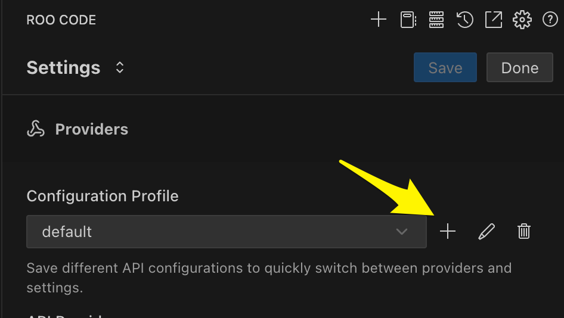

3. Enter a name for your new profile

    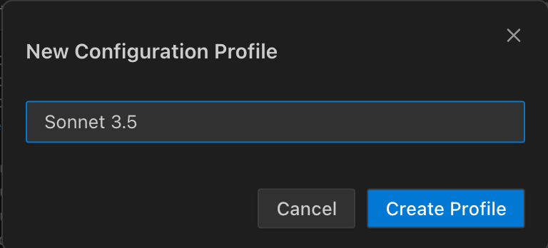

4. Configure the profile settings:

    - Select your API provider
         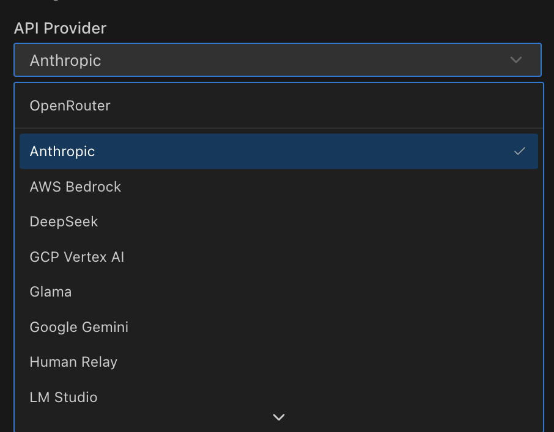
    - Enter API key

         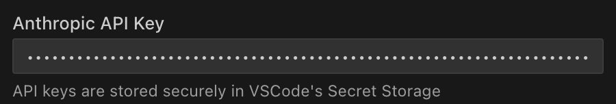

    - Choose a model

         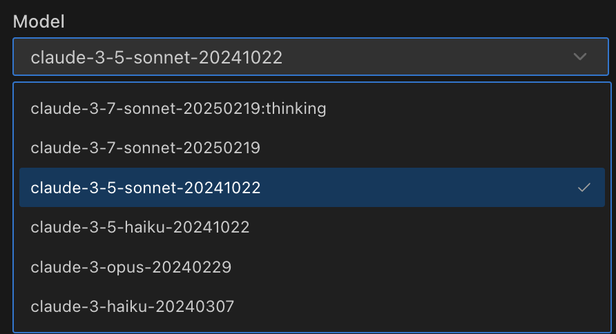

    - Configure the **Rate Limit** for this profile:

        - **Default is 0 (disabled), which is suitable for most users.** If needed, you can set a minimum time (in seconds) between API requests _for this profile_ to help manage costs or avoid provider rate limits.
        - A value of 0 disables rate limiting (default).
        - Requests using other profiles follow their own rate limits.

              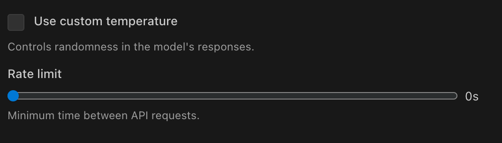

    - Adjust model parameters (like [temperature](model-temperature.md))

### Switching Profiles

Switch profiles in two ways:

1. From Settings panel: Select a different profile from the dropdown

    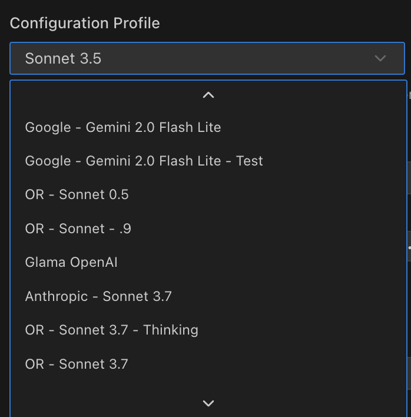

2. During chat: Access the API Configuration dropdown in the chat interface

    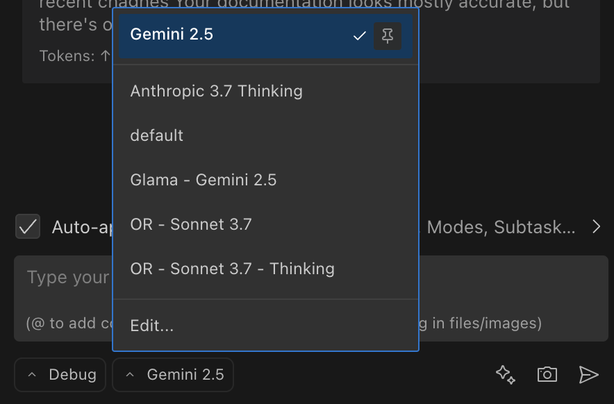

### Pinning and Sorting Profiles

The API configuration dropdown now supports pinning your favorite profiles for quicker access:

1. Hover over any profile in the dropdown to reveal the pin icon
2. Click the pin icon to add the profile to your pinned list
3. Pinned profiles appear at the top of the dropdown, sorted alphabetically
4. Unpinned profiles appear below a separator, also sorted alphabetically
5. You can unpin a profile by clicking the same icon again

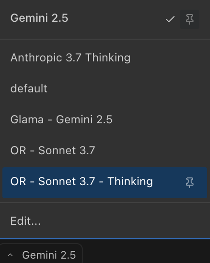

This feature makes it easier to navigate between commonly used profiles, especially when you have many configurations.

### Editing and Deleting Profiles

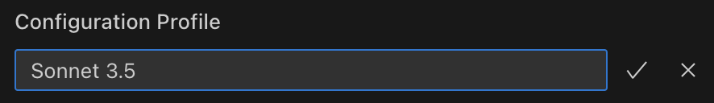
- Select the profile in Settings to modify any settings
- Click the pencil icon to rename a profile
- Click the trash icon to delete a profile (you cannot delete the only remaining profile)

---

## Linking Profiles to Roles

Open Settings ⚙️ → **Roles** to give each role (mode) its own profile and model:

1. Pick the role to edit with the selector at the top of the page.
2. Under **API Configuration**, choose the profile this role should use.
3. Choose the model. The list is loaded from the profile selected for this role, using that profile's provider, endpoint, and credentials. Leaving the profile's own model selected means the role follows that profile's model.
4. Click **Save**.

How the Roles page relates to the rest of the extension:

- **Independent of Providers.** The profile selected in Settings → Providers is only the default. It is used by roles with no assignment and does not change the profile or the model list of roles that have one.
- **Independent of the chat.** Choosing a role in Settings → Roles only opens it for editing. It does not change the mode of the current chat, and changing the chat's mode does not change which role is open in Settings. Creating or importing a role does not switch the chat to it either.
- **Applied at runtime.** Tasks and subtasks read these assignments: a task in a role runs with that role's profile and model.

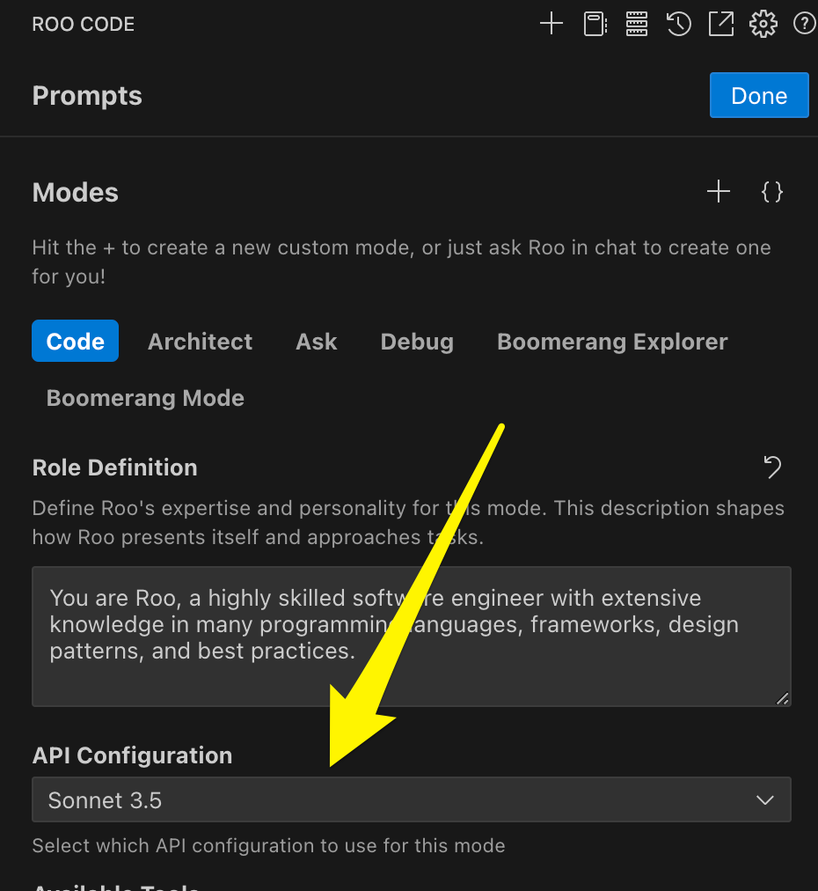

---

## Per-Task Profile Persistence

Each task remembers which profile it started with. This "sticky" behavior means:

- **Reopening from history**: When you resume a task from history, it uses the same profile it had originally—even if you've since changed the global selection.
- **Multi-workspace consistency**: If you switch profiles in another workspace window, existing tasks in the first window keep their original profile.
- **Orchestrator subtasks**: Each child task uses the profile and model assigned to its role in [Settings → Roles](#linking-profiles-to-roles) (or the default profile if its role has none) and keeps it for its lifetime.

This prevents unexpected model switches mid-task and keeps your conversation context consistent with the model that generated it.

---

## Security Note

API keys are stored securely in VSCode's Secret Storage and are never exposed in plain text.

---

## Related Features

- Works with [custom modes](custom-modes.md) you create
- Integrates with [local models](../advanced-usage/local-models.md) for offline work
- Supports [temperature settings](model-temperature.md) per mode
- Supports per-profile rate limits (configured here) and general [usage tracking/cost info](../advanced-usage/rate-limits-costs.md)
- Supports diff-based editing (see [`apply_diff`](../advanced-usage/available-tools/apply-diff.md)).
